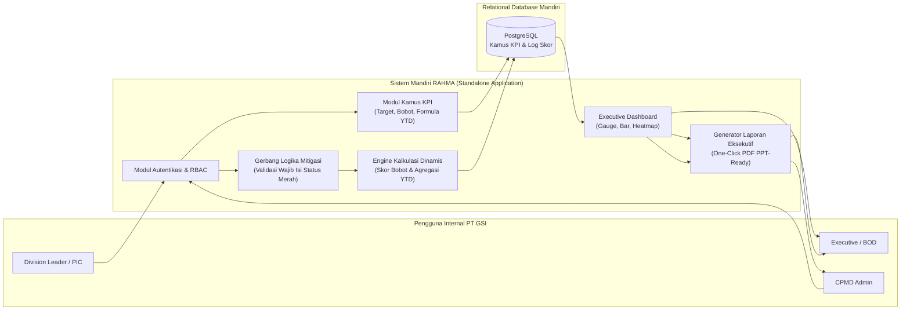
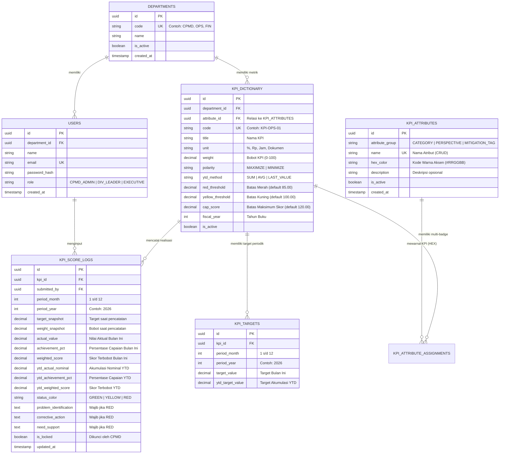

# Product Requirements Document (PRD): Sistem Pemantauan KPI Mandiri "RAHMA"

| Informasi Dokumen | Detail |
| :--- | :--- |
| **Nama Produk** | **RAHMA** (Real-time Analytical Hub for Management & Accountability) |
| **Organisasi Target** | PT Global Service Indonesia (GSI) |
| **Pemilik Proses Bisnis** | Divisi Corporate Planning & Management Development (CPMD) |
| **Mode Arsitektur** | Standalone SaaS Web Application (Zero External Integration - Fase 1) |
| **Model Pengembangan** | Solo Developer Optimized |
| **Status Dokumen** | v1.0.0 — Implemented & Verified |
| **Tanggal** | 18 November 2026 |

---

## 1. Latar Belakang & Masalah (Problem Statement)

Saat ini, proses pemantauan dan evaluasi Key Performance Indicator (KPI) tingkat departemen di **PT Global Service Indonesia (GSI)** menghadapi tiga hambatan struktural utama:

1. **Proses Terisolasi (Siloed) & Manual Berbasis Presentasi Kuartalan**
   Evaluasi performa departemen dikerjakan secara manual menggunakan file spreadsheet terpisah dan dirapel ke dalam slide presentasi PowerPoint setiap akhir kuartal. Tidak ada sumber kebenaran tunggal (*Single Source of Truth*) yang dapat diakses sewaktu-waktu.
2. **Distorsi Peran Divisi CPMD menjadi "Penagih Utang" Administratif**
   Divisi CPMD kehilangan banyak waktu produktif karena harus terus-menerus menagih, mengumpulkan, memvalidasi format, dan merekonsiliasi laporan KPI dari masing-masing *Division Leader*. Beban klerikal ini mengalihkan fokus CPMD dari fungsi utamanya sebagai perumus strategi makro.
3. **Deteksi Masalah Operasional yang Terlambat (Lagging Crisis Detection)**
   Karena evaluasi baru dikonsolidasikan di akhir kuartal, deviasi performa dan kendala operasional di tingkat departemen tidak terdeteksi sejak dini. Masalah baru terlihat oleh manajemen puncak ketika sudah membesar menjadi krisis di akhir kuartal.

---

## 2. Objektif & Benefit (Objectives & Business Value)

### 2.1 Objektif Sistem
1. **Digitalisasi & Sentralisasi Real-Time:** Mengubah pelacakan KPI departemen dari dokumen statis kuartalan menjadi sistem web terpusat yang memproses pembaruan data secara *real-time* dan mandiri (*standalone*).
2. **Transformasi Peran CPMD:** Membebaskan divisi CPMD dari beban administratif pengumpulan laporan sehingga dapat fokus 100% pada perumusan pelaporan strategis makro dan analisis arah bisnis PT GSI.
3. **Early Warning & Fondasi Analitik:** Membangun fondasi pencatatan data historis yang terstruktur untuk memantau tren performa, mendeteksi anomali lebih awal, dan memaksa penyusunan rencana mitigasi segera saat target tidak tercapai.

### 2.2 Metrik Keberhasilan (Success Metrics)
* **0 Jam** waktu lembur rekonsiliasi manual spreadsheet ke PowerPoint oleh tim CPMD menjelang rapat evaluasi.
* **100% KPI Berstatus Merah** wajib memiliki dokumentasi akar masalah (*Problem Identification*), langkah perbaikan (*Corrective Action*), dan kebutuhan dukungan (*Need Support*) pada saat data disubmit.
* **< 5 Detik** waktu yang dibutuhkan untuk menghasilkan laporan eksekutif siap presentasi (*One-Click Executive PDF Report*).

---

## 3. Pengguna & Hak Akses (User Personas & RBAC)

| Role | Deskripsi Pengguna | Hak Akses Utama |
| :--- | :--- | :--- |
| **CPMD Admin** | Tim Corporate Planning & Management Development PT GSI | Mengelola master departemen, menyusun **Kamus KPI** (target, bobot, polaritas, metode agregasi YTD), membuka/mengunci periode pelaporan, memantau seluruh departemen, dan mengekspor laporan eksekutif. |
| **Division Leader / PIC** | Kepala Divisi / Departemen atau staf yang ditunjuk | Menginput realisasi (*Actual*) KPI departemennya sendiri, mengisi form mitigasi wajib jika performa di bawah ambang batas, serta melihat dashboard performa internal divisinya. |
| **Executive (BOD / Direksi)** | Jajaran Direksi dan Manajemen Puncak PT GSI | Akses *Read-Only* ke **Executive Dashboard** lintas departemen, *heatmap* performa, tren YTD, daftar *Need Support* yang membutuhkan keputusan manajemen, serta unduh laporan PDF. |

---

## 4. Fitur Utama & Spesifikasi Fungsional

### 4.1 Parameter Input UI (Pelaporan KPI & Mitigasi)
Antarmuka input dirancang ringkas namun ketat terhadap kelengkapan data:
* **Identitas & Parameter KPI:** Menampilkan Nama KPI, Satuan (*Unit*), Polaritas (Maximize / Minimize), Bobot KPI (%), dan Target Periode berjalan.
* **Input Realisasi:** Kolom input **Actual** (nilai realisasi periode berjalan).
* **Input Mitigasi Risiko:**
  * **Problem Identification (Deteksi Akar Masalah):** Penjelasan terstruktur mengenai penyebab tidak tercapainya target.
  * **Corrective Action (Tindakan Perbaikan):** Langkah konkret dan terukur yang akan diambil divisi.
  * **Need Support (Bantuan Manajemen):** Eskalasi dukungan lintas divisi atau keputusan BOD yang dibutuhkan untuk menyelesaikan hambatan.

### 4.2 Kalkulasi Dinamis (Dynamic Calculation Engine)
Sistem menghitung skor secara otomatis setiap kali nilai *Actual* dimasukkan:

1. **Formula Pencapaian berdasarkan Polaritas Tugas:**
   * **Polaritas Positif (*Higher is Better* — misal: Pendapatan, SLA Tercapai):**
     $$\text{Achievement (\%)} = \left(\frac{\text{Actual}}{\text{Target}}\right) \times 100\%$$
   * **Polaritas Negatif (*Lower is Better* — misal: Jumlah Komplain, Biaya Operasional, Downtime):**
     $$\text{Achievement (\%)} = \left(2 - \frac{\text{Actual}}{\text{Target}}\right) \times 100\% \quad \text{(atau proporsi inversi sesuai batas plafon skor)}$$
   * **Batas Atas (*Score Capping*):** Opsional batas maksimum pencapaian (misal maksimal 120%) agar satu KPI ekstrem tidak menutupi kegagalan KPI lainnya.

2. **Kalkulasi Bobot Nilai (Weighted Score):**
   $$\text{Weighted Score} = \text{Achievement (\%)} \times \left(\frac{\text{Bobot KPI}}{100}\right)$$
   Total bobot seluruh KPI aktif dalam satu departemen wajib berjumlah **100%**.

3. **Akumulasi Year-to-Date (YTD) Otomatis (Nominal & Persentase):**
   Berdasarkan jenis metrik di Kamus KPI, sistem mengakumulasi nilai Januari s.d. bulan berjalan menggunakan metode yang sesuai:
   * `SUM` (Akumulatif): Untuk metrik volume/nominal (misal: Total Penjualan, Jumlah Proyek Selesai).
   * `AVG` (Rata-rata): Untuk metrik rasio/indeks bulanan (misal: % Kepuasan Pelanggan, % Uptime).
   * `LAST_VALUE` (Nilai Akhir): Untuk metrik posisi kumulatif (misal: Jumlah Headcount Aktif).

### 4.3 Gerbang Logika Mitigasi (Mandatory Risk Mitigation Gate)
> [!IMPORTANT]
> **Aturan Bisnis Kritis:** Sistem menerapkan *Hard Validation Gate* baik di sisi antarmuka (*Client-side*) maupun server (*Server-side API*).

* **Klasifikasi Status Warna (Traffic Light Indicator):**
  * 🟢 **Hijau (On Track):** Pencapaian $\ge 100\%$
  * 🟡 **Kuning (Warning):** Pencapaian $85\% \le x < 100\%$
  * 🔴 **Merah (Critical / Tidak Capai Target):** Pencapaian $< 85\%$ (ambang batas dapat dikonfigurasi oleh CPMD, atau $< 100\%$ sesuai kebijakan ketat).
* **Perilaku Gerbang Logika:**
  * Begitu pengguna mengetikkan angka *Actual* yang menghasilkan status **Merah**, sistem secara otomatis membuka dan memberi penanda wajib (*required*) pada kolom **Problem Identification**, **Corrective Action**, dan **Need Support**.
  * Tombol **Submit / Simpan** akan dinonaktifkan (*disabled*) atau ditolak oleh server (`HTTP 422 Unprocessable Entity`) apabila salah satu dari ketiga kolom tersebut kosong atau hanya berisi teks terlalu pendek (minimal 15 karakter bermakna).

### 4.4 Executive Dashboard & One-Click PDF Report
Antarmuka visual strategis yang dirancang **PPT-Ready** (rasio proporsional, tipografi bersih, kontras tinggi untuk layar proyektor rapat direksi):
* **Speedometer / Gauge Chart:** Skor agregat korporat dan skor per departemen (Bulan Berjalan vs YTD).
* **Bar Chart Perbandingan:** Perbandingan *Target vs Actual* serta peringkat performa antar departemen.
* **Performance Heatmap:** Matriks visual (Departemen $\times$ Bulan/KPI) dengan kode warna Hijau/Kuning/Merah untuk mendeteksi tren penurunan performa secara instan.
* **Tabel Eskalasi Manajemen (Actionable Insights):** Daftar terfilter khusus KPI berstatus Merah lengkap dengan *Problem Identification*, *Corrective Action*, dan *Need Support* agar rapat direksi langsung berfokus pada pengambilan keputusan.
* **One-Click Executive Report (Export to PDF):** Tombol ekspor instan yang merender ringkasan dashboard eksekutif dan tabel mitigasi ke dalam dokumen PDF berformat *Landscape A4 / 16:9 Presentation Layout* siap cetak dan siap tampil.

### 4.5 Fitur UI High-Impact & Low-Friction (Kemudahan Penggunaan dengan Dampak Signifikan)
Untuk memastikan adopsi pengguna yang tinggi tanpa menambah kompleksitas teknis bagi *solo developer*, sistem dilengkapi 5 fitur UI praktis berdaya ungkit tinggi:

1. **Inline Spreadsheet-Like Input & Auto-Save Draft (Bagi Division Leader):**
   * Pengisian angka *Actual* dirancang dalam tabel interaktif di mana pengguna dapat berpindah antar baris KPI cukup dengan tombol `Tab` / `Enter` seperti di Excel (tanpa perlu membuka-tutup modal satu per satu).
   * Setiap teks mitigasi yang diketik otomatis tersimpan sebagai *Draft* di browser/database sehingga pengguna tidak kehilangan ketikan jika koneksi terputus.
2. **Smart Mitigation Chips & Guided Prompt (Standarisasi Akar Masalah):**
   * Saat Gerbang Logika Mitigasi terbuka (status Merah), tersedia **Quick-Tag Chips** sekali klik untuk kategori kendala umum (misal: `[Kendala Vendor]`, `[Keterbatasan SDM]`, `[Keterlambatan Material]`, `[Menunggu Approval BOD]`, `[Faktor Eksternal/Cuaca]`).
   * *Placeholder* terpandu otomatis memformat isian *Corrective Action* menjadi pola **"Apa tindakan + Target Selesai + PIC"** sehingga laporan ke direksi selalu konkret dan tidak berisi alasan normatif.
3. **CPMD Submission Tracker & "1-Click Copy Reminder" (Penghapus Beban Tagih Manual):**
   * Bar progres visual di halaman CPMD yang menampilkan status pelaporan seluruh departemen bulan ini: `Selesai Submit (Hijau)`, `Draft / Belum Lengkap (Kuning)`, dan `Belum Input (Merah)`.
   * Tombol **"Salin Pengingat (WhatsApp/Email)"** yang dalam 1 klik menyalin teks rekap otomatis berisi daftar departemen yang belum melengkapi laporan ke *clipboard*—memangkas waktu koordinasi CPMD tanpa memerlukan integrasi API pihak ketiga.
4. **Boardroom Presentation Mode & "Red-Only Spotlight Toggle" (Bagi Rapat Direksi):**
   * **Tombol Mode Rapat (`Full-Screen Presentation View`):** Menyembunyikan seluruh menu navigasi/sidebar, memperbesar ukuran font dan grafik agar terbaca jelas di proyektor ruang rapat.
   * **Toggle "Fokus Indikator Merah (`Red-Only Spotlight`)":** Satu sakelar (*switch*) di atas dashboard untuk menyembunyikan seluruh KPI Hijau/Kuning dan hanya menyorot KPI Merah beserta permintaan *Need Support*-nya, mempercepat jalannya rapat evaluasi hingga 50%.
5. **MoM Delta Badge & Mini-Trend Sparkline (Deteksi Dini Arah Tren):**
   * Di samping setiap skor KPI, tampil lencana perubahan *Month-over-Month* (contoh: `▲ +6.4% vs Bulan Lalu` atau `▼ -11.2% vs Bulan Lalu`) beserta grafik garis mini (*6-month sparkline*).
   * Membantu BOD dan CPMD membedakan antara KPI Kuning/Merah yang **sedang membaik** vs KPI yang **terus merosot** selama 3 bulan berturut-turut (*Early Crisis Indicator*).
6. **Manajemen CRUD Atribut KPI Dinamis & Warna Aksen Kustom (HEX Color-Coded Badges):**
   * **Full CRUD Nama & Kelompok Atribut:** CPMD Admin dapat menambah, mengubah nama, mengaktifkan/menonaktifkan, dan menghapus atribut pengelompokan KPI secara mandiri (misalnya atribut **Perspektif/Kategori Tugas**: *Financial, Customer, Operational Excellence, HSE/Safety, Strategic Initiative*, maupun atribut **Tag Mitigasi**).
   * **Kustomisasi Warna Aksen Tingkat HEX (`#RRGGBB`):** Setiap atribut dilengkapi pengaturan warna aksen yang dapat dipilih melalui *Visual Color Picker*, palet preset korporat, atau pengetikan langsung kode **HEX 6-digit** (contoh: `#0F766E`, `#DC2626`, `#7C3AED`).
   * **Auto-Contrast & Aksentuasi Menyeluruh:** Sistem otomatis menyesuaikan kontras teks/border dari kode HEX yang dimasukkan dan menerapkannya secara konsisten sebagai *color-coded badge* serta garis aksen baris pada tabel input KPI, filter *Executive Dashboard*, dan dokumen hasil ekspor PDF.
7. **Progressive Disclosure UI & Perincian Individu Indikator (Individual KPI Deep-Dive Drawer/Modal):**
   * **Tampilan Utama Ringkas (*High-Signal Summary View*):** Tabel dan kartu pada UI utama hanya menampilkan metrik esensial tingkat eksekutif (Kode & Nama KPI, Divisi, Badge Warna HEX, Skor/Capaian Utama, MoM Delta, dan Status Warna) agar layar bebas dari kepadatan informasi (*visual clutter*).
   * **Panel Perincian Tiap Indikator (*Individual KPI Detail View*):** Saat pengguna mengklik salah satu baris KPI atau tombol **`🔍 Rincian`**, sistem membuka panel detail individu yang memuat seluruh informasi mendalam yang tidak ditampilkan di tabel utama: parameter teknis formula (Polaritas, Metode YTD, Ambang Merah, Plafon Skor, Bobot), grafik tren performa 12 bulan penuh (Januari–Desember), tabel log histori bulanan, rincian lengkap dokumen mitigasi (*Problem ID, Corrective Action, Need Support*), serta metadata waktu pembaruan terakhir.

---

## 5. Arsitektur Sistem (Standalone Architecture)

Sistem RAHMA dirancang sebagai aplikasi mandiri (*standalone monolith*) tanpa ketergantungan pada API eksternal (seperti Odoo atau CLA) pada rilis Fase 1. Hal ini menjamin kecepatan pengembangan oleh *solo developer*, kemudahan *deployment*, dan isolasi gangguan.

### 5.1 Rekomendasi Tech Stack (Optimal untuk Solo Developer)
* **Framework Full-Stack:** Next.js (App Router, TypeScript) atau Laravel — menyatukan Frontend UI dan Backend API dalam satu repositori (*Monorepo/Monolith*).
* **UI & Visualisasi:** Tailwind CSS + shadcn/ui + Recharts / ApexCharts (untuk Bar Chart, Speedometer Gauge, dan Heatmap).
* **Database Relasional:** PostgreSQL (atau SQLite/MySQL untuk kemandirian *single-server deployment*) dengan Prisma ORM / Drizzle ORM.
* **PDF Engine:** `@react-pdf/renderer` atau Puppeteer/Playwright print-to-PDF stylesheet khusus `@media print` berformat 16:9 slide.

### 5.2 Diagram Arsitektur & Alur Kerja Sistem

### 5.3 Skema Database Relasional (ERD)

---

## 6. User Stories & Acceptance Criteria

### Epic 1: Manajemen Kamus KPI, Bobot & Atribut Berwarna (CPMD Admin)

#### US-1.1: Konfigurasi Kamus KPI & Validasi Bobot 100%
* **Sebagai** CPMD Admin,
* **Saya ingin** mendaftarkan dan mengatur parameter KPI setiap departemen (Target, Bobot, Polaritas, Atribut, dan Metode Akumulasi YTD),
* **Sehingga** sistem dapat menghitung skor performa secara baku tanpa perlu mengubah rumus manual di spreadsheet.

**Acceptance Criteria:**
* **Given** CPMD Admin berada di halaman Manajemen Kamus KPI untuk suatu departemen,
* **When** Admin menambahkan atau mengubah bobot KPI dalam satu tahun fiskal,
* **Then** sistem menghitung total bobot seluruh KPI aktif di departemen tersebut dan menampilkan peringatan jika totalnya belum tepat `100%`.
* **Given** sebuah KPI memiliki jenis tugas kumulatif (misal: Pendapatan) atau rata-rata (misal: SLA),
* **When** Admin memilih `ytd_method` (`SUM`, `AVG`, atau `LAST_VALUE`) dan `polarity` (`MAXIMIZE` atau `MINIMIZE`),
* **Then** sistem menyimpan konfigurasi tersebut sebagai acuan kalkulasi otomatis pada saat Division Leader menginput nilai aktual.

#### US-1.2: CRUD Nama Atribut KPI & Warna Aksen Tingkat HEX
* **Sebagai** CPMD Admin,
* **Saya ingin** membuat, mengubah nama, dan menghapus atribut pengelompokan KPI (seperti Kategori Tugas, Perspektif Strategis, atau Tag Mitigasi) beserta warna aksennya yang dapat dikustomisasi hingga kode HEX (`#RRGGBB`),
* **Sehingga** setiap KPI memiliki identitas visual (*color-coded accent*) yang konsisten dan mudah dikenali saat ditinjau di tabel input maupun Executive Dashboard.

**Acceptance Criteria:**
* **Given** CPMD Admin membuka menu **Kelola Atribut KPI**,
* **When** Admin membuat atau mengedit sebuah atribut dengan mengisi `Nama Atribut` dan memilih warna melalui *Color Picker* atau mengetikkan kode HEX langsung (contoh: `#1D4ED8`),
* **Then** sistem memvalidasi format HEX (`^#([A-Fa-f0-9]{6})$`), menampilkan *Live Preview Badge* dengan kontras teks yang terbaca jelas, dan menyimpan atribut ke tabel `kpi_attributes`.
* **Given** sebuah atribut memiliki warna HEX tertentu dan telah dihubungkan ke beberapa item KPI,
* **When** Admin mengubah nama atau kode HEX atribut tersebut,
* **Then** seluruh lencana (*badge*), filter kategori, dan aksen baris KPI terkait di halaman Input, *Executive Dashboard*, dan laporan PDF otomatis diperbarui menggunakan nama dan warna HEX terbaru.
* **Given** sebuah atribut masih digunakan oleh KPI aktif,
* **When** Admin mencoba menghapus atribut tersebut,
* **Then** sistem mencegah penghapusan paksa (*restrict delete*) dan menawarkan opsi menonaktifkan (*archive*) atau memindahkan KPI ke atribut lain terlebih dahulu.

---

### Epic 2: Input Realisasi, Kalkulasi Dinamis & Gerbang Mitigasi (Division Leader)

#### US-2.1: Kalkulasi Real-Time Skor Bulanan dan Akumulasi YTD
* **Sebagai** Division Leader,
* **Saya ingin** melihat hasil persentase pencapaian, skor terbobot, dan akumulasi YTD langsung terhitung otomatis saat saya menginput angka *Actual*,
* **Sehingga** saya langsung mengetahui posisi performa divisi saya tanpa perlu menghitung manual.

**Acceptance Criteria:**
* **Given** Division Leader membuka form pelaporan KPI bulan berjalan,
* **When** ia memasukkan angka pada kolom `Actual`,
* **Then** sistem secara *real-time* (< 200ms di UI) menampilkan:
  1. Persentase Pencapaian Bulan Berjalan (%),
  2. Skor Terbobot (*Weighted Score*),
  3. Akumulasi YTD (Nominal & Persentase) dari bulan Januari hingga bulan yang dipilih,
  4. Indikator warna status (`GREEN`, `YELLOW`, atau `RED`).

#### US-2.2: Gerbang Logika Mitigasi Wajib Isi (Mandatory Mitigation Gate)
* **Sebagai** CPMD Admin dan Direksi,
* **Saya ingin** sistem memaksa Division Leader mengisi *Problem Identification*, *Corrective Action*, dan *Need Support* setiap kali ada KPI yang berstatus Merah,
* **Sehingga** setiap ketidaktercapaian target selalu disertai analisis akar masalah dan rencana tindak lanjut sebelum laporan masuk ke meja rapat.

**Acceptance Criteria:**
* **Given** Division Leader menginput nilai `Actual` pada suatu KPI,
* **When** hasil kalkulasi menunjukkan status **Merah (`RED`)** (pencapaian di bawah ambang batas target),
* **Then** sistem secara otomatis menampilkan dan mewajibkan pengisian kolom:
  1. `Problem Identification` (Deteksi Akar Masalah),
  2. `Corrective Action` (Tindakan Perbaikan),
  3. `Need Support` (Bantuan dari Manajemen).
* **Given** status KPI adalah **Merah (`RED`)** dan salah satu dari ketiga kolom mitigasi masih kosong atau berisi kurang dari 15 karakter,
* **When** pengguna menekan tombol **Simpan / Submit**,
* **Then** sistem menolak penyimpanan, menampilkan pesan validasi yang jelas pada kolom yang belum lengkap, dan API mengembalikan status error validasi (`422`).
* **Given** status KPI adalah **Hijau (`GREEN`)** atau **Kuning (`YELLOW`)**,
* **When** pengguna menyimpan laporan tanpa mengisi kolom mitigasi,
* **Then** sistem mengizinkan penyimpanan data (kolom mitigasi bersifat opsional).
* **Given** panel Gerbang Logika Mitigasi terbuka pada baris KPI berstatus **Merah (`RED`)**,
* **When** pengguna mengklik salah satu **Quick-Tag Chip** kategori masalah (misal: `[Kendala Vendor]`) dan mulai mengetik,
* **Then** tag tersebut otomatis disisipkan sebagai awalan terstruktur pada `Problem Identification` dan sistem menyimpan draf ketikan secara otomatis (*Auto-Save Draft*).

---

### Epic 3: Executive Dashboard, Mode Rapat & Pelacak Kepatuhan (CPMD & BOD)

#### US-3.1: Visualisasi Executive Dashboard (PPT-Ready) & Mode Fokus Rapat
* **Sebagai** Eksekutif (BOD) dan CPMD,
* **Saya ingin** melihat ringkasan performa seluruh departemen dalam bentuk grafik visual (Speedometer, Bar Chart, Heatmap, dan Sparkline Tren MoM) serta dapat mengaktifkan Mode Rapat dan Filter Fokus Merah dengan 1 klik,
* **Sehingga** evaluasi rapat berjalan fokus pada penyelesaian masalah kritis tanpa perlu membuat slide PowerPoint manual.

**Acceptance Criteria:**
* **Given** pengguna membuka halaman Executive Dashboard dan memilih filter Periode (Bulan & Tahun) serta mode tampilan (`Monthly` atau `YTD`),
* **When** halaman dimuat,
* **Then** sistem menampilkan:
  1. **Speedometer / Gauge Chart** rata-rata pencapaian korporat dan per departemen,
  2. **Bar Chart** perbandingan *Target vs Actual* dan skor antar departemen,
  3. **Performance Heatmap** matriks departemen dan status warna KPI beserta **MoM Delta Badge (`▲/▼ % vs Bulan Lalu`)** dan **Mini-Sparkline**,
  4. **Executive Mitigation Summary Table** yang merangkum seluruh KPI berstatus Merah beserta *Problem ID*, *Corrective Action*, dan *Need Support*.
* **Given** rapat evaluasi sedang berlangsung,
* **When** pengguna mengaktifkan sakelar **"Fokus Indikator Merah (`Red-Only Spotlight`)"** dan tombol **"Mode Rapat (`Presentation Mode`)"**,
* **Then** antarmuka menyembunyikan sidebar navigasi, memperbesar tipografi untuk proyektor, dan memfilter tampilan hanya pada KPI berstatus Merah yang membutuhkan keputusan manajemen.

#### US-3.2: Pelacak Kepatuhan Pelaporan & 1-Click Copy Reminder (CPMD View)
* **Sebagai** CPMD Admin,
* **Saya ingin** melihat daftar departemen yang sudah maupun belum mengumpulkan laporan KPI bulan berjalan dan menyalin pesan pengingat otomatis dalam satu klik,
* **Sehingga** saya tidak perlu lagi mengecek satu per satu atau mengetik pesan tagihan laporan secara manual.

**Acceptance Criteria:**
* **Given** CPMD Admin membuka panel **Submission Tracker** pada periode aktif,
* **When** masih ada departemen dengan status `Belum Input` atau `Draft`,
* **Then** sistem menampilkan progres kepatuhan (misal: `8/12 Departemen Selesai`) dan tombol **"Salin Pesan Pengingat"** yang menyalin teks siap kirim (berisi daftar nama departemen yang belum lengkap) ke *clipboard*.

#### US-3.3: One-Click Executive PDF Export
* **Sebagai** CPMD Admin atau BOD,
* **Saya ingin** mengunduh tampilan Executive Dashboard beserta daftar mitigasi dalam format PDF hanya dengan satu klik,
* **Sehingga** dokumen tersebut dapat langsung dibagikan atau ditampilkan di layar rapat direksi.

**Acceptance Criteria:**
* **Given** pengguna berada di halaman Executive Dashboard,
* **When** pengguna menekan tombol **"Export Executive Report (PDF)"**,
* **Then** sistem menghasilkan file PDF berorientasi *Landscape (16:9 / A4 Landscape)* dalam waktu kurang dari 5 detik yang memuat:
  * Halaman 1: Ringkasan Eksekutif Korporat (Speedometer, Bar Chart Perbandingan Departemen, & Heatmap Performa).
  * Halaman 2+: Tabel Detail KPI per Departemen dan Matriks Mitigasi Risiko (*Problem Identification*, *Corrective Action*, *Need Support*) untuk seluruh indikator Merah.

#### US-3.4: Progressive Disclosure UI & Panel Perincian Individu Indikator (KPI Drill-Down)
* **Sebagai** Eksekutif (BOD), CPMD Admin, dan Division Leader,
* **Saya ingin** tampilan utama dashboard hanya menyajikan ringkasan indikator yang paling krusial, namun menyediakan tampilan perincian individu (*deep-dive modal/drawer*) saat sebuah indikator diklik,
* **Sehingga** layar utama tetap bersih dan mudah dipindai secara cepat, sementara informasi teknis, histori 12 bulan, dan detail mitigasi tetap dapat ditelusuri secara mendalam per indikator.

**Acceptance Criteria:**
* **Given** pengguna melihat daftar KPI pada Executive Dashboard atau Papan Eskalasi,
* **When** tabel utama dirender,
* **Then** kolom yang ditampilkan dibatasi pada informasi esensial (Identitas KPI & Badge Utama, Divisi, Capaian/Skor Utama, MoM Delta, Status Warna, dan tombol **`🔍 Rincian`**), sedangkan metadata teknis (Polaritas, Metode YTD, Ambang Merah, Plafon Skor, dan rincian panjang) disembunyikan dari tabel utama.
* **Given** pengguna mengklik baris KPI atau tombol **`🔍 Rincian`** pada suatu indikator,
* **When** modal/drawer **Perincian Individu Indikator** terbuka,
* **Then** sistem menampilkan:
  1. Identitas lengkap KPI, PIC Division Leader, dan seluruh badge **Multi-Atribut Warna HEX** beserta deskripsinya,
  2. Perbandingan lengkap *Bulan Berjalan vs Akumulasi YTD* (Target, Actual, % Capaian, dan Skor Terbobot),
  3. Konfigurasi formula teknis (`Bobot %`, `Polaritas`, `Metode YTD`, `Ambang Merah`, `Plafon Skor`, dan waktu pembaruan terakhir),
  4. Grafik visual tren performa 12 bulan (Januari–Desember) dan tabel log histori bulanan lengkap untuk indikator tersebut,
  5. Dokumen lengkap *Problem Identification*, *Corrective Action*, dan *Need Support* serta pintasan langsung untuk mengedit realisasi indikator tersebut.

---

## 7. Breakdown Engineering Tasks (Solo Developer Roadmap)

Timeline dan pembagian tugas dirancang secara modular agar dapat diselesaikan secara efisien oleh **1 orang Full-Stack Developer (Solo Developer)** dalam waktu **6–8 Minggu**.

### Fase 1: Desain & Arsitektur (Minggu 1 – 2)
Fokus: Penajaman UI/UX PPT-Ready dan fondasi struktur data relasional.

- [ ] **TASK-1.1: Wireframing & High-Fidelity Mockup UI/UX**
  - Merancang layout *Executive Dashboard* berasio proporsional presentasi (Speedometer, Bar Chart, Heatmap, MoM Delta Badge, serta *Boardroom Presentation Mode*).
  - Merancang *Inline Spreadsheet-Like Input Form* dengan transisi visual saat Gerbang Logika Mitigasi aktif (munculnya panel *Problem ID, Corrective Action, Need Support* lengkap dengan *Quick-Tag Chips* ketika indikator berubah merah).
  - Merancang layout cetak PDF (*Print Layout 16:9*) agar tidak ada grafik yang terpotong saat diekspor.
- [ ] **TASK-1.2: Perancangan Skema Database Relasional & Seeding**
  - Menginisialisasi proyek aplikasi dan database mandiri (PostgreSQL + ORM).
  - Mengimplementasikan tabel `departments`, `users`, `kpi_attributes`, `kpi_dictionary`, `kpi_targets`, dan `kpi_score_logs`.
  - Membuat *database indexing* pada `(department_id, period_year, period_month)` untuk menjamin kueri agregasi YTD tetap instan.
  - Membuat *seed script* berisi data awal departemen PT GSI, atribut KPI berwarna default (beserta kode HEX), dan contoh Kamus KPI untuk pengujian.

### Fase 2: Core Development (Minggu 3 – 6)
Fokus: Implementasi mesin kalkulasi, gerbang validasi, dashboard, dan ekspor PDF.

- [ ] **TASK-2.1: Autentikasi Mandiri & Role-Based Access Control (RBAC)**
  - Implementasi login internal berbasis sesi/JWT untuk 3 role (`CPMD_ADMIN`, `DIV_LEADER`, `EXECUTIVE`).
  - Pembatasan middleware agar `DIV_LEADER` hanya dapat mengedit data departemennya sendiri.
- [ ] **TASK-2.2: Modul CRUD Kamus KPI, CRUD Atribut Berwarna (HEX), & CPMD Submission Tracker**
  - Pembuatan halaman **CRUD Atribut KPI Dinamis** (tambah/ubah/hapus nama atribut, pengelompokan, serta *Visual Color Picker + Input Kode HEX `#RRGGBB`* dengan kalkulasi kontras teks otomatis).
  - Pembuatan halaman kelola Kamus KPI (input kode, nama, atribut warna, satuan, bobot, polaritas, dan metode YTD) serta validasi otomatis total bobot $= 100\%$.
  - Pembuatan widget **CPMD Submission Tracker** beserta fitur **1-Click Copy Follow-Up Reminder** ke *clipboard*.
- [ ] **TASK-2.3: Engine Kalkulasi Dinamis, Agregasi YTD & MoM Delta**
  - Pembuatan modul/service murni (*pure functions*) untuk menghitung `% Achievement` (mendukung polaritas `MAXIMIZE` dan `MINIMIZE` serta *score capping*).
  - Implementasi kalkulasi *Weighted Score* berdasarkan bobot KPI serta selisih performa *Month-over-Month (MoM Delta)*.
  - Implementasi agregator otomatis *Year-to-Date (YTD)* (Nominal & Persentase) untuk metode `SUM`, `AVG`, dan `LAST_VALUE` lintas bulan dalam tahun berjalan.
- [ ] **TASK-2.4: Implementasi Inline Input UI, Quick-Tag Mitigasi & Gerbang Logika**
  - Pembuatan antarmuka input bulanan bergaya *inline spreadsheet* (navigasi `Tab`/`Enter`) untuk Division Leader dengan *live preview* skor dan *Auto-Save Draft*.
  - Implementasi *Quick-Tag Mitigation Chips* dan *Client-side & Server-side Validation Gate* (Zod / Validator): mewajibkan pengisian `problem_identification`, `corrective_action`, dan `need_support` jika `status_color == 'RED'`.
- [ ] **TASK-2.5: Pembangunan Executive Dashboard Visual & Mode Rapat Direksi**
  - Integrasi komponen grafik: *Speedometer/Gauge Chart* (skor korporat/divisi), *Bar Chart* (Target vs Actual), *Performance Heatmap*, dan *6-Month Mini Sparklines*.
  - Pembuatan toggle **Red-Only Spotlight** (filter instan khusus KPI Merah) dan tombol **Boardroom Presentation Mode** (tampilan layar penuh untuk proyektor rapat).
- [ ] **TASK-2.6: Fitur One-Click Executive PDF Export**
  - Pembuatan generator laporan PDF mandiri yang mengubah tampilan *Executive Dashboard* dan tabel mitigasi menjadi dokumen PDF berformat presentasi tanpa memerlukan pengolahan ulang di PowerPoint.

### Fase 3: Testing & Rilis Operasional (Minggu 7 – 8)
Fokus: Pengujian akurasi matematis, ketahanan sistem mandiri, dan serah terima ke CPMD.

- [ ] **TASK-3.1: Unit Testing & Stress Test Pemrosesan Data Mandiri**
  - Menulis *unit test* untuk seluruh skenario rumus pembobotan, polaritas negatif/positif, *edge case* pembagian nol (`target = 0`), dan kalkulasi YTD 12 bulan.
  - Melakukan *stress test* dan simulasi beban data multi-tahun (misal: 15 departemen $\times$ 15 KPI $\times$ 36 bulan histori) untuk memastikan waktu muat dashboard tetap `< 1 detik`.
- [ ] **TASK-3.2: User Acceptance Testing (UAT) bersama Divisi CPMD**
  - Melakukan simulasi end-to-end bersama tim CPMD menggunakan data riil kuartal sebelumnya untuk membandingkan hasil kalkulasi RAHMA vs perhitungan manual.
  - Menguji skenario penolakan form saat indikator Merah disubmit tanpa mitigasi.
  - Memvalidasi kesesuaian tata letak hasil *One-Click PDF* untuk kebutuhan rapat direksi PT GSI.
- [ ] **TASK-3.3: Deployment Mandiri & Go-Live Operasional**
  - Menyiapkan lingkungan produksi mandiri (*Docker container* / VPS internal PT GSI) lengkap dengan *automated daily database backup*.
  - Pelatihan singkat (*onboarding*) untuk CPMD Admin dan para Division Leader serta perilisan resmi untuk operasional bulanan/harian.

---

## 8. Risiko Teknis & Mitigasi (Khusus Arsitektur Standalone)

| Risiko | Dampak | Strategi Mitigasi |
| :--- | :--- | :--- |
| **Perubahan Bobot atau Target KPI di Tengah Tahun Berjalan** | Mengubah histori skor bulan-bulan sebelumnya yang sudah dilaporkan ke BOD. | Menyimpan `target_snapshot` dan `weight_snapshot` di dalam tabel `kpi_score_logs` setiap kali laporan bulanan dikunci (*locked*), sehingga histori masa lalu tetap utuh (*immutable*). |
| **Ketiadaan Integrasi ERP di Fase Awal** | Pengguna masih perlu menginput angka *Actual* secara manual ke dalam RAHMA. | Menyediakan antarmuka input tabel yang sangat cepat (*keyboard-friendly*) serta fitur *Lock Period* oleh CPMD setelah masa pelaporan selesai agar data terjaga. |
| **Kehilangan Data pada Server Standalone** | Seluruh Kamus KPI dan histori performa terdampak jika terjadi kegagalan disk. | Mengaktifkan *cron job* backup database harian otomatis ke penyimpanan terpisah, menyediakan tombol *Export Backup (.JSON)* bagi CPMD Admin, serta **Offline Auto-Backup** di browser per akun. |

---

## 9. Ringkasan Implementasi Aktual (v1.0.0)

Berikut fitur dan penyempurnaan arsitektur yang telah dibangun pada codebase saat ini:

1. **Autentikasi RBAC Sungguhan & Halaman Auth Terpisah (`/login`, `/signup`):**
   - `src/db.js` menyimpan kata sandi ter-hash (`scryptSync` + `timingSafeEqual`).
   - `server.js` menerbitkan cookie sesi `HttpOnly` bertanda tangan HMAC-SHA256 dan menerapkan guard `401`/`403` termasuk isolasi departemen untuk `DIV_LEADER`.
   - Halaman `/login` (`public/login.html`) dan `/signup` (`public/signup.html`) dilengkapi pratinjau peran interaktif, meteran kekuatan sandi, dan tombol isi cepat akun demo.
2. **Pengaturan Akun Bercabang & Verifikasi OTP Email:**
   - Modal pengaturan akun di dashboard memiliki 5 cabang: **Profil & Avatar** (foto avatar 256×256 per akun, ubah nama/jabatan), **Keamanan & OTP** (ubah email & kata sandi dengan kode OTP 6-digit), **Tampilan & Kaca** (wallpaper preset, foto PC terakhir, & intensitas *frosted glass*), **Preferensi & Data** (mode default Monthly/YTD & konfirmasi perubahan belum disimpan), serta **Tentang Rahma** (`Versi 1.0.0`).
3. **Sistem Visual, Tipografi & Cetak PDF Eksekutif:**
   - Menggunakan *co-branding* **Rahma** (`#007BC8`) dan **PT Global Service Indonesia (GSI)**, tipografi **Figtree** (Title & Body/UI) dan **IBM Plex Mono** (`<kbd>`/Monospace), serta desain *Beveled Frosted Glass*.
   - **Sidebar Retractable:** Saat sidebar disembunyikan (`☰`), topbar menampilkan logo **Rahma | GSI** (menggantikan tombol Mode Rapat yang redundan).
   - **One-Click Executive PDF (`@media print`):** Mencetak laporan A4 Landscape dengan kartu grafik datar (*flat* putih tanpa bayangan/blur), warna aksen khusus sebagai *outline* kartu, serta tabel Heatmap 12 bulan + YTD penuh tanpa terpotong.
4. **Homepage Komersial (`/home`):**
   - Halaman promosi produk (`public/home.html`) dengan simulator interaktif SVG Gauge YTD, Simulator Gerbang Mitigasi `< 85%`, Matriks RBAC & Auto-Backup Offline, paket lisensi B2B, serta transisi *fade-in* logo Rahma di navbar saat di-scroll.
